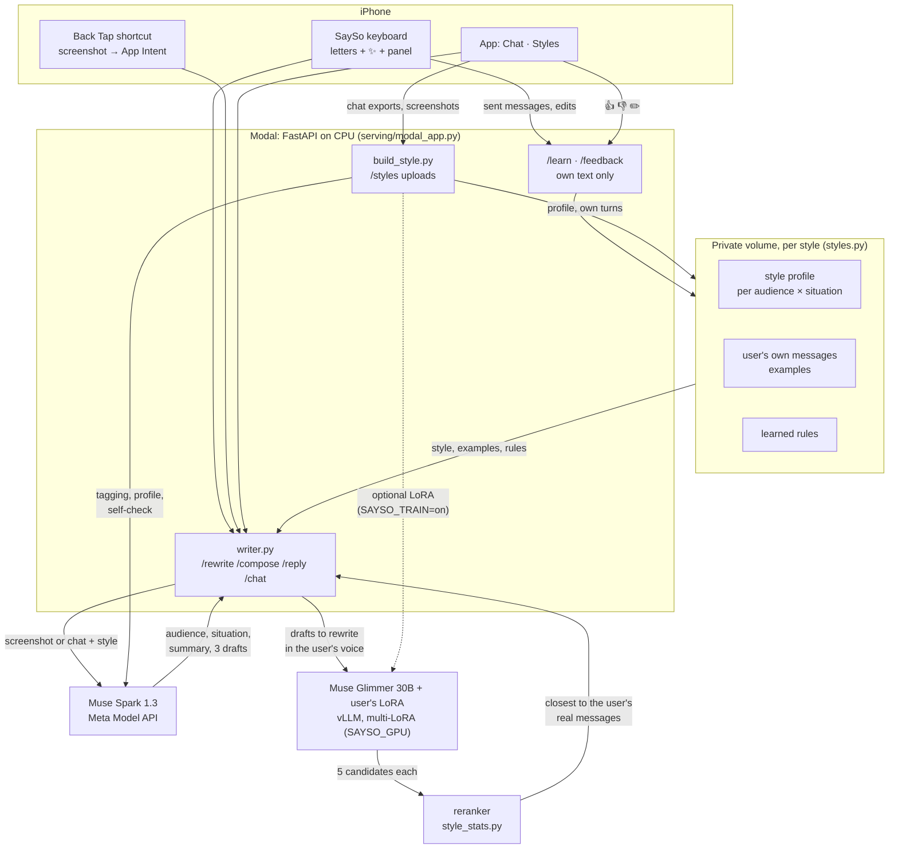

# SaySo: an AI that writes the way you'd say it

SaySo writes messages the way **you** write them: your length, your case and punctuation, your slang, the way you
react to good news or a complaint, and how all of that changes between your partner, friends, family and elders.
It lives where you type: **its own iOS keyboard** (normal letter keys plus a ✨ key that rewrites or writes in your
style), a **Back Tap shortcut** (double-tap the back of the iPhone → screenshot → three replies in your voice) and an
**in-app chat** for longer things. It keeps learning: messages you send with the SaySo keyboard become new examples, and
every 👍, 👎 or edit in the chat becomes an example or a short rule ("keep messages to family short").

Built solo during the **Meta Global AI Developer Hackathon** (indie track, Oct 27 – Nov 4, 2026) on Meta's
**Muse Spark 1.3** and the open-weights **Muse Glimmer 30B**.

> **Status, honestly.** The user's own LoRA on Muse Glimmer 30B is trained and benchmarked (numbers below), and the
> server can run it on Modal or Baseten. Right now nothing is hosting it: Modal credits are nearly used up, Fireworks
> uploads are disabled service-wide, and the hackathon Baseten key only serves Muse Spark Open. So the deployed server
> runs with `SAYSO_GPU=off`, and **Muse Spark writes in the user's style on its own** (style profile + the user's real
> example messages + learned rules). The demo shows that mode. Turning the LoRA back on is one environment variable.

---

## What it does

| Surface | What happens |
|---|---|
| **SaySo keyboard** | Its own RU/EN letter keys (Kazakh letters on long-press). The strip on top has an audience chip (the AI suggests one), a format chip, and ✨. Type a draft, tap ✨, get 1–3 versions in your style, tap one to insert. A *series* comes as a stack you send one message at a time. The **panel** has Rewrite / Write / Replies (the latest screenshot replies). You always send the message yourself. |
| **Back Tap → replies** | One iOS Shortcut: *Take Screenshot* → SaySo App Intent → `/reply`. Muse Spark reads the chat, guesses the audience and situation, and returns three replies with different intents (for example agree / refuse / joke). You pick one from the list and it's copied. The keyboard's Replies tab shows the same three. |
| **Chat in the app** | Write / Rewrite / Reply with an audience and a format. Under each answer: Copy, 👍, 👎, ✏️. A 👎 with "shorter" rewrites the answer, and if the feedback says something lasting, it becomes a rule of the style ("✨ Learned: …"). |
| **Styles** | Upload chat exports (Telegram, WhatsApp, Instagram), screenshots or frames of a screen recording. SaySo asks which participant is you and who each chat is with, then builds a style: profile, examples, a self-check score, and optionally its own LoRA. |

**Formats:** `message` (one chat message), `series` (2–4 short messages, the way you split a thought), `official`
(a polite message for a work or study chat) and `email`. The formal ones override casual habits such as lowercase,
slang and emoji, but keep your plain wording.

---

## How it works



### The writing path (`serving/writer.py`)

1. **Read.** For a reply, Muse Spark 1.3 gets the screenshot (or pasted messages) plus the style: per audience,
   the usual length, share of lowercase starts, end punctuation, laughter and swearing, and how often the user agrees,
   jokes, teases, asks back and so on in each situation. It returns the audience (and the top 3 guesses), the situation
   (request, invitation, good news, sadness, conflict, joke, thanks, apology, logistics, …), a neutral 20–30-word
   summary of the other person's messages, and **three drafts with different intents**. Nothing from the screenshot
   is stored. Only the user's suggested replies are cached for the keyboard, never the summary.
2. **Ground in real messages.** Every Spark prompt carries up to 8 of the user's real messages to that audience
   (from the uploaded chats, plus messages sent with the keyboard and answers they liked or fixed), and the rules
   learned from their feedback. Formal formats get no casual examples, so they don't drift back into lowercase chat.
3. **Rewrite in the user's voice** (when the GPU is on). The style's LoRA on Muse Glimmer 30B rewrites each draft.
   Rewriting is its strongest task, see the benchmark. It samples 5 candidates per draft.
4. **Rerank** (`pipeline/style_stats.py`). Instead of scoring against the user's *average* message, which pushes
   every answer toward the mode, it draws one of the user's real messages from the same audience × situation and picks
   the candidate whose features (length, lines, emoji, laughter, signature words, …) are closest. Over many requests the
   output follows the user's distribution.
5. If the LoRA is off, cold, or the format is `official`/`email`, Spark's styled draft is returned at once
   (`styled: false`), so the app never waits on a GPU.

Rewrite and compose follow the same path without the reading step. Without a chat (summary only), the main style's
v4 adapter "thinks first": it writes `act · tone · gist` in Glimmer's `to=self` channel, then the message. Act and tone
are drawn from the user's profile, which makes the intent controllable.

### Building a style from uploads (`serving/build_style.py`)

`parsing` (Telegram HTML/JSON, WhatsApp `.txt`/`.zip`, Instagram JSON via `pipeline/sources.py`; screenshots and
screen-recording frames are read by Spark, right-side bubbles = you, overlapping frames de-duplicated) →
`needs_me` (the app asks **which one is you** and confirms each chat's audience, which Spark guesses) →
`reading` (Spark tags each of your turns: situation, neutral summary, act · tone · gist, and a neutral draft plus an
instruction for training pairs) → `profile` → pairs → `checking` (**self-check**: held-out replies written in the new
style vs a no-style baseline, form similarity to your real replies, and Spark as a judge of whether they make sense) →
optional `training` of the style's own LoRA (`SAYSO_TRAIN=on`, at least 150 turns) → `ready`.

### Learning from use

- **Keyboard → `/learn`.** When a message is sent with the SaySo keyboard, the keyboard queues it. A suggestion sent
  unchanged is not counted as the user's own wording. A suggestion the user changed is sent along with their version,
  and Spark may turn the difference into a rule. Links, emails, phone and card numbers are stripped. The new messages
  serve as examples on the very next request.
- **Chat → `/feedback`.** 👍 keeps the answer as an example, ✏️ keeps the user's version and may teach a rule, 👎 with
  a comment revises the answer and may teach a rule.
- The style card lists what was learned, and each item can be deleted ("Learned from you").

### The main style's LoRA (offline pipeline)

The author's own model was trained on their Telegram Desktop exports (`pipeline/parse_telegram.py`): own messages
only, consecutive messages merged into one *turn*, URLs, phones, emails, card numbers and media removed, no chat above
35% of the set, the last weeks held out for test. Pairs (`pipeline/build_pairs.py`): **rewrite** (Muse Spark Open writes
a neutral version → the real message), **compose** (Muse Spark Open writes an instruction → the real message), **reply**
(situation + neutral summary from base Glimmer → the real reply). QLoRA with Unsloth on a Modal H100
(`training/modal_train.py`, r=16, lr 2e-4, 2 epochs, loss on the response). Versions: v1, v2 (more context), v3 (SimPO on
word choice: worse, dropped), and **v4** (thought in the `to=self` channel, then the message), which is the one served.

---

## Meta models and their roles

| Model | Where | Role in SaySo |
|---|---|---|
| **Muse Spark 1.3** | Meta Model API (`muse-spark-1.3`) | Reads screenshots and pasted chats (audience, situation, neutral summary). Drafts replies, rewrites and messages guided by the style profile and the user's real messages. Tags uploaded chats when building a style, judges the self-check, and turns feedback into rules. In the current GPU-off mode it writes everything. |
| **Muse Glimmer 30B** (open weights) + the user's LoRA | vLLM on Modal (`serving/modal_app.py`) or Baseten (`serving/baseten/`), switched with `SAYSO_GPU` | The personal model: rewrites drafts in the user's voice and writes on its own with a "thought first" (v4). Base Glimmer also tagged situations and thoughts for the training data, so other people's messages never left our own hosted model in the offline pipeline. |
| **Muse Spark Open** (`muse-spark-open-1026`) | Baseten | Built the neutral drafts and instructions for the main style's training pairs. It is the open-weights fallback for the drafting step, and the candidate for self-hosting it later. |

---

## Results

All numbers come from the author's own held-out messages. Only aggregated metrics are committed
(`eval/results/*.json`), never message text.

**Metrics.**
- **Fingerprint ↓**: mean normalized gap to the user's real messages over about 15 stylometric features (length, lines,
  end punctuation, lowercase starts, emoji, laughter, swearing, Latin/Kazakh share, …). 0 means the same averages.
- **chrF ↑**: character n-gram F-score against the user's real message for the same input.
- **Memorized ↓**: outputs copying a training message verbatim or sharing a 40-character span with one.

### 1. The personal LoRA vs prompting the same base model

499 held-out pairs (250 reply, 143 rewrite, 106 compose), `eval/results/bench_2026-10-28.json`:

| System | Fingerprint ↓ | chrF ↑ (all) | chrF rewrite | chrF compose | Median length | Memorized |
|---|---:|---:|---:|---:|---:|---:|
| Base Glimmer, same prompt | 2.64 | 13.1 | 28.5 | 22.8 | 73 chars | 0.2% |
| Glimmer + 5 of the user's own messages (few-shot) | 1.02 | 20.5 | 40.7 | 25.5 | 27 chars | 3.8% |
| **Glimmer + the user's LoRA (v1)** | **0.04** | **28.9** | **57.2** | **42.5** | 19 chars | 0.6% |

The user's real messages average about 28 characters. Replies are the hardest task: guessing someone's exact answer is
close to impossible (chrF on replies is 0.2 / 6.8 / 7.0 for the three systems), which is why replies are drafted by
Spark, which sees the whole chat, and then rewritten by the LoRA.

### 2. v4: thought first, then the message

`eval/results/bench_v4.json` and `docs/PLAN_v4_thinking.md`. Same 499 pairs, 5 candidates each. The act and tone of
every reply were re-tagged by base Glimmer. That tagger agrees with its own earlier labels only 48% of the time, so
about 48% is the ceiling for act match, and always guessing the most common act scores 36.8%.

| | v2 | v4 | v4 + rerank | v4 with act/tone from the profile |
|---|---:|---:|---:|---:|
| Act match on replies | 44% | 40% | **46%** | 42% |
| Tone mix gap (TV ↓) | 0.09 | 0.11 | 0.12 | **0.06** |
| Fingerprint ↓ (all tasks) | 0.075 | 0.072 | 0.045 | **0.044** |
| Reply length (real: 28 chars) | 38 | – | – | **24** |

Takeaway: the thought does not make the model read the user's mind better (both are near the tagger's noise), but it
makes the mood mix and the length match the user, and the act becomes a **control**: prefill `act: agree`,
`act: refuse` or `act: joke` to get three options with different intents in the user's voice.

### 3. What the style adds to Muse Spark (the mode running now)

40 held-out rewrite pairs, Muse Spark 1.3 writing alone. **Form similarity** = 1 − total variation between the outputs
and the user's real messages over 7 form features (length bucket, lowercase start, end punctuation, laughter, emoji,
swearing, question). It is the same score as the in-app self-check (`build_style.similarity`); 1 means the two can't be
told apart by form. **chrF** is against the user's real message. Script: `eval/style_gain.py`.

| Muse Spark 1.3 … | Form similarity ↑ | chrF ↑ |
|---|---:|---:|
| generic (no style) | 0.67 | 41.0 |
| + style profile | 0.91 | 47.3 |
| **+ style profile + the user's real example messages** | **0.94** | **51.4** |

### 4. Latency (measured Oct 29 with the GPU warm)

`/reply` from a summary 2.4 s, from pasted messages 6 s, from a screenshot 9.7 s, `/compose` 7 s (`docs/REVIEW.md`).

### 5. Blind test

> **TODO:** blind test with friends (compose tasks only, no third-party messages shown; real vs SaySo vs generic).
> Not run yet. No numbers until it is, and the protocol is written before running.

---

## Privacy

- **Only the user's own messages are stored.** Other people's messages, from uploads or screenshots, are read in
  memory to understand the situation, sent to Muse Spark for that reading, and dropped. They are never written to
  the volume, the datasets or the training pairs. Tested in `tests/test_styles.py` (builds a style from a made-up
  WhatsApp chat and asserts that none of the other person's lines are written) and `tests/test_privacy.py` (scans
  everything under `data/` for incoming text from the real exports).
- Screenshots are processed in memory. The keyboard's "latest replies" cache holds the user's suggested replies and
  the situation tag, never the summary of the other person's messages.
- The keyboard learns only from what the user sends, never from other people's text. It skips password, email,
  URL, number, one-time-code and search fields (any field with a content type), and learning can be paused in its
  settings. Typing works without Full Access; the network features need it.
- **Keys live in `.env` and Modal secrets, never in the repo.** vLLM has its own key, never shipped in the app.
  `data/`, exports, adapters and generated iOS secrets are gitignored.
- Styles, learned items and rules can be deleted from the app. SaySo describes *how you write*, never your
  personality. It's framed as your own voice with you in the loop: you always send the message yourself.

---

## Scaling and unit economics (estimates)

**Architecture at scale.** One shared Muse Glimmer 30B base on vLLM, with per-user LoRA adapters (r=16, tens of MB)
loaded from object storage and swapped per request (multi-LoRA vLLM; runtime adapter loading is already used for new
styles). One GPU serves thousands of users because the base weights are shared.

**Tiers.** *Free*: Muse Spark with the user's style profile, examples and learned rules (the mode running now).
*Pro*: plus the user's own LoRA, refreshed from what they send.

**Cost per active user per month, rough estimates, not measured at scale:**

| Item | Now | After optimization |
|---|---:|---:|
| Muse Spark (~900 generations + 150 screenshots/month) | ≈ $2.4 | |
| GPU share: one rented H100 ≈ $1,450/month serving 5–10k actives | ≈ $0.2–0.3 | |
| Periodic LoRA refresh | ≈ $0.5 | |
| Infra (API, storage) | ≈ $0.1 | |
| **Total** | **≈ $3–3.5** | **≈ $1–1.5** (self-hosted Muse Spark Open for drafting + prompt caching) |

Price idea: **$6.99/month** for Pro. At small scale a 24/7 GPU is too expensive per user, so until roughly 2–5k users
the LoRA would be served per token (Fireworks / Together multi-LoRA), and a dedicated GPU after that.

---

## Repo map

```
serving/    modal_app.py    Modal app: vLLM (Glimmer + LoRAs, H100) and the FastAPI API on CPU
            writer.py       read → draft → rewrite → rerank; formats; chat; /learn and /feedback logic
            styles.py       per-style storage: meta, own turns, profile, pairs, rules, feedback, learned
            build_style.py  uploads → parse → which one is you → Spark tagging → profile → pairs → self-check → LoRA
            baseten/        the same vLLM server as a Truss (SAYSO_GPU=baseten)
            fireworks.py    Fireworks client (blocked: uploads disabled)
pipeline/   parse_telegram.py, parse_whatsapp.py, parse_instagram.py, sources.py   parsers → one turn format
            situations.py   situation / thought tagging with base Glimmer
            build_pairs.py  rewrite / compose / reply pairs (Muse Spark Open)
            style_profile.py, style_stats.py (reranker), lexicon.py, add_thoughts.py
training/   modal_train.py (Unsloth QLoRA), build_prefs.py + modal_prefs.py (SimPO, v3), fireworks_sft.py
eval/       bench_generate.py, metrics.py, smoke_api.py, results/ (aggregated metrics only)
tests/      test_styles.py, test_privacy.py, test_parsers.py, fixtures/ (made-up chats only)
ios/        SaySoApp/ (Styles, Chat, Keyboard settings, Setup, App Intents), SaySoKeyboard/, Shared/, scripts/
docs/       plans, review, design brief, SUBMISSION.md
```

## How to run

You need a Modal account, a Meta Model API key, and for the personal model the Glimmer weights and an adapter on the
`sayso-data` volume. Your own data never goes in the repo.

```bash
cp .env.example .env    # fill META_API_KEY, SAYSO_API_URL, SAYSO_API_TOKEN, …
```

```bash
python3 -m venv .venv && .venv/bin/pip install modal httpx
```

Modal secrets: `sayso` (`SAYSO_API_TOKEN`), `sayso-glimmer` (`GLIMMER_KEY`), `sayso-meta` (`META_API_KEY`), and
optionally `sayso-baseten`.

```bash
SAYSO_GPU=off .venv/bin/modal deploy serving/modal_app.py
```

Use `SAYSO_GPU=modal` or `SAYSO_GPU=baseten` to serve the LoRA, and add `SAYSO_TRAIN=on` to let new styles train their
own LoRA.

**Smoke test the deployed API** (made-up inputs only):

```bash
.venv/bin/python eval/smoke_api.py
```

```bash
.venv/bin/python eval/smoke_api.py --spark --show
```

(`--gpu` also warms the GPU and checks `/rewrite /compose /reply`; `--gpu --vision tests/fixtures/chat.png` reads a
screenshot.)

**Unit tests** (no network, no GPU; tests that need the private exports skip):

```bash
python3 -m unittest discover -s tests
```

**iOS** (Xcode, iOS 26): generate the API URL and token for the app from `.env`, then open the project, set your
signing team, and run the `SaySo` scheme on a device. Add the keyboard in Settings → Keyboards, and create the
*Take Screenshot → SaySo* shortcut for Back Tap.

```bash
sh ios/scripts/gen_secrets.sh
```

```bash
open ios/SaySo.xcodeproj
```

## Current limits

- **Single-user server.** One bearer token for the whole API, readable from the app binary. Fine for a demo, not for
  release. Next: per-device tokens (Sign in with Apple / App Attest).
- **GPU off by default** (`SAYSO_GPU=off`). The personal LoRA is trained and benchmarked but not hosted live right now,
  so the demo's text comes from Muse Spark with the style profile and examples.
- **Per-style LoRA is behind `SAYSO_TRAIN`** (off). New styles get a profile, examples and a self-check; their own
  LoRA needs a GPU run (~10–30 min on an H100) and at least 150 of the user's turns.
- The LoRA writes only the chat formats (`message`, `series`); `official` and `email` are always written by Spark.
- The keyboard needs Full Access for network features. Free signing expires every 7 days.
- Blind test not run yet (see Results).
- Muse Spark reads other people's messages in screenshots and uploads to understand them (in memory, not stored by
  SaySo). The offline pipeline used our own hosted Glimmer for that instead; moving live reading there is planned.

---

Built during the hackathon, commit by commit. Small commits show what was built when.
