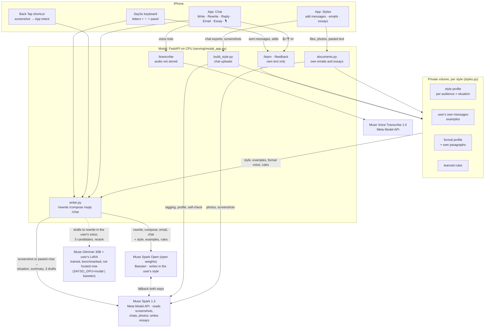

# SaySo: an AI that writes the way you'd say it

SaySo writes messages the way **you** write them: your length, your case and punctuation, your slang, the way you
react to good news or a complaint, and how all of that changes between your partner, friends, family and elders.
It also writes your **emails and essays** in your own formal voice, learned from emails and essays you wrote yourself.
It lives where you type: **its own iOS keyboard** (normal letter keys plus a ✨ key that rewrites or writes in your
style), a **Back Tap shortcut** (double-tap the back of the iPhone → screenshot → three replies in your voice) and an
**in-app chat** for longer things (Write, Rewrite, Reply, Email, Essay, with 🎙 voice input). It keeps learning:
once you turn learning on, messages you type and send with the SaySo keyboard become new examples, and every 👍, 👎 or
edit in the chat becomes an example or a short rule ("keep messages to family short").

Built solo during the **Meta Global AI Developer Hackathon** (indie track, Oct 27 – Nov 4, 2026) on four Meta
models: the open-weights **Muse Spark Open** writes, **Muse Spark 1.3** reads, **Muse Voice Transcribe 1.0** listens,
and the open-weights **Muse Glimmer 30B** carries the user's own LoRA.

> **Status, honestly.** Every message, email and rewrite in the live app is written by **Muse Spark Open**, Meta's
> open-weights model, served by Baseten (hackathon key, `reasoning_effort: low`, about 2–8 s per answer), guided by
> the user's style profile, their real example messages and the rules learned from their feedback. **Muse Spark 1.3**
> (Meta Model API) reads screenshots, pasted chats and photos, drafts the Back Tap replies and writes essays, and each
> of the two is the fallback for the other.
> The user's own **LoRA on Muse Glimmer 30B** is trained and benchmarked (numbers below), and the server can run it on
> Modal or Baseten, but nothing is hosting it right now: Modal credits are nearly used up, Fireworks uploads are
> disabled service-wide, and the hackathon Baseten key serves only Muse Spark Open. So the deployed server runs with
> `SAYSO_GPU=off`. Turning the LoRA back on is one environment variable.

---

## What it does

| Surface | What happens |
|---|---|
| **SaySo keyboard** | Its own RU/EN letter keys (Kazakh letters on long-press). The strip on top has an audience chip (the AI suggests one), a format chip, and ✨. Type a draft, tap ✨, get 1–3 versions in your style, tap one to insert. A *series* comes as a stack you send one message at a time. The **panel** has Rewrite / Write / Replies (the latest screenshot replies, or paste their messages). Settings in the app's Keyboard tab: audiences, formats, number of variants, haptics, accent, "Capital letter at sentence start" (off by default, since most people who write like this write lowercase) and "Learn from what I type" (off by default). You always send the message yourself. |
| **Back Tap → replies** | One iOS Shortcut: *Take Screenshot* → SaySo App Intent → `/reply`. Muse Spark 1.3 reads the chat, guesses the audience and situation, and returns three replies with different intents (for example agree / refuse / joke). You pick one from the list and it's copied. The keyboard's Replies tab shows the same three. |
| **Chat in the app** | Five modes, each with an audience and a format. **Write** (an instruction → your message), **Rewrite** (your draft → your wording), **Reply** (paste their messages). **Email**: subject + body from your notes, optionally answering an email you paste. **Essay**: a plan and the text, built only from your own notes, then up to 3 questions whose answers would make it stronger. 🎙 records a voice note and Muse Voice Transcribe turns it into text, so notes, drafts and answers to those questions can be spoken. Under each answer: Copy, 👍, 👎, ✏️. 👎 offers one-tap reasons (Too long, Too formal, Too casual, Not my words, Wrong meaning, Too rude; for emails and essays: Shorter, Longer, More personal, Simpler words, Less formal) or your own words, typed or spoken. The answer is rewritten, and if the feedback says something lasting, it becomes a rule of the style ("✨ Learned: …"). |
| **Styles** | An **Add** menu with three kinds of source, each with step-by-step guides per app. **Messages (chats)**: WhatsApp, Telegram, Instagram exports, or screenshots / a screen recording for iMessage and any other app. SaySo asks which participant is you and who each chat is with, then builds a style: profile, examples, a self-check score, and optionally its own LoRA. **Emails** and **Essays & documents**: your own writing as files (.txt, .docx, .pdf, Google Takeout .mbox), photos or screenshots, or pasted text, which becomes your formal voice. The tab has one section per kind of text, picked with tabs at the top: **Messages** (the self-check score, how you write to each audience), **Emails** (tone and length, your greetings and sign-offs) and **Essays** (structure, sentence length, linking words), each with a "Teach me" card when it is empty. Lists can be edited by hand: **Opens with** and **Signs off with** for emails (add, remove, reorder, mark a default; the writer uses yours in the email's language) and **phrases you never use** for each kind. |
| **Learned from you** | The style card lists every message the keyboard learned from and every rule taken from your corrections. Each one can be deleted. Its **Formal writing** section shows what was learned from your emails and essays (sentence length, linking words, how you open and sign off). |

**Formats:** `message` (one chat message), `series` (2–4 short messages, the way you split a thought), `official`
(a polite message for a work or study chat) and `email`; the chat's Essay mode writes `essay`. The formal ones use
your **formal voice** (below) instead of your chat habits such as lowercase, slang and emoji, but keep your plain
wording.

---

## How it works



### The writing path (`serving/writer.py`)

1. **Read** (replies only). Muse Spark 1.3 gets the screenshot (or pasted messages) plus the style: per audience,
   the usual length, share of lowercase starts, end punctuation, laughter and swearing, and how often the user agrees,
   jokes, teases, asks back and so on in each situation. It returns the audience (and the top 3 guesses), the situation
   (request, invitation, good news, sadness, conflict, joke, thanks, apology, logistics, …), a neutral 20–30-word
   summary of the other person's messages, and **three drafts with different intents**. With the GPU off (now), these
   drafts are the replies the user sees. Nothing from the screenshot is stored. Only the user's suggested replies are
   cached for the keyboard, never the summary.
2. **Write in the user's style.** For ✨, rewrite, compose, chat answers and emails, **Muse Spark Open** writes with
   the style profile, up to 8 of the user's real messages to that audience (their newest and approved ones first, then
   the ones closest in words and spelling, picked on our own server with TF-IDF), and the rules learned from their
   feedback. The prompt tells it to keep the user's habits (fillers, laughter, swearing, emoji, splitting a thought
   into several messages) at the user's own rate for that audience, instead of writing cleaner than they do. It
   returns its answer plus 4 more variants, which become the alternatives under ✨. Spark Open always
   reasons; `reasoning_effort: low` keeps the thought short (2.7 s instead of 5.5 s in our test). If it fails, Muse
   Spark 1.3 answers instead, and if Spark 1.3 fails, Spark Open does. A compose answer that just repeats the
   instruction ("tell her…") is rewritten by Spark 1.3.
3. **Formal formats** (`official`, `email`, `essay`) get the user's formal voice instead of their chat messages, so
   they don't drift back into lowercase chat (see below). Official messages and emails are written in the language
   of the request (Russian in, Russian out, unless it asks for another), with only the greetings, sign-offs and
   paragraphs of the user's formal writing in that language, nothing the request doesn't say (no "we", no offers,
   no invented details), and the person the text names ("ask the professor…") wins over the audience chip. Every
   variant is checked: a second sign-off is removed, and one that still mixes languages or adds filler is dropped;
   if none is left, Muse Spark 1.3 writes it once more with the problems named.
4. **When the GPU is on** (`SAYSO_GPU=modal` or `baseten`), the style's LoRA on Muse Glimmer 30B rewrites each chat
   draft in the user's voice (rewriting is its strongest task, see the benchmark), samples 5 candidates, and a
   reranker (`pipeline/style_stats.py`) draws one of the user's real messages from the same audience × situation and
   picks the candidate whose features (length, lines, emoji, laughter, signature words, …) are closest, so the output
   follows the user's distribution instead of their average. If the LoRA is cold, or the format is formal, the styled
   draft is returned at once (`styled: false`), so the app never waits on a GPU. Without a chat (summary only), the
   main style's v4 adapter "thinks first": it writes `act · tone · gist` in Glimmer's `to=self` channel, then the
   message.

### Emails and essays in the user's formal voice (`serving/documents.py`)

Chats teach how the user writes to friends; their own emails and essays teach how they write when it's official.
In the style card or the Add menu, the user adds **Emails** or **Essays & documents**: `.txt`, `.md`, `.docx`, `.pdf`,
a Google Takeout `.mbox` (Sent label only), pasted text, or photos and screenshots that Muse Spark 1.3 transcribes
(handwritten lines joined into paragraphs, crossed-out words left out, mail app headers and the signature block after
the sign-off skipped, names of other people and companies replaced with `[Name]`). Each source has a
step-by-step guide in the app (Gmail and Apple Mail screenshots, copy and paste, print to PDF, Takeout; photos of
pages, Word / Pages / Google Docs).

What is kept is only the user's own text: quoted earlier messages in emails (someone else's text) are cut off, links,
emails, phone and card numbers are removed, and section labels of old assignments ("Thesis:", "Argument 2:") are cut.
From that, SaySo builds a **formal profile** (sentence length, the linking words the user actually uses, how they open
and sign off) and keeps their paragraphs as examples. The two kinds teach different things:

- **Essays teach voice only**: word choice, sentence length, linking words, how direct the user is. Never their
  structure, headings or topic. The structure comes from the new task.
- **Emails teach manner only**: how the user greets, asks and signs off, how formal and direct they are. Never what
  those emails said.

The author's own style currently holds 8 emails they sent and 11 handwritten essay pages (photographed, names masked
as `[Name]`); only those paragraphs and the formal profile are stored, on the private volume.

**Email mode** writes a subject and a body from the user's notes (spoken or typed), optionally answering an email they
paste, with every fact from the notes and nothing invented. **Essay mode** plans first (4–6 points), then writes in
the structure the question asks for (an argument, a personal statement, a story, …; a natural essay without headings
if nothing is asked), in the first person and active voice when it is about the user, using only facts from the
user's notes. It reaches the length by explaining the user's facts, never by padding; if the notes are too thin it
writes shorter and asks. Then it checks itself: too long or containing AI clichés ("in today's fast-paced world",
"plays a crucial role", "delve", and their Russian counterparts) → one fix pass. It ends with up to 3 questions whose
answers would make the essay stronger; the user answers by voice or text and the essay is revised. Essays are written
by Muse Spark 1.3; emails by Muse Spark Open.

### Voice notes (`/transcribe`)

🎙 in the chat records a voice note; **Muse Voice Transcribe 1.0** writes it down and it goes out like typed text
(an instruction, a draft, notes for an essay, an answer to one of its questions). The audio is read in memory and not
stored.

- **Recording:** mono 16-bit **24 kHz** WAV (Muse Voice Transcribe takes 16 or 24 kHz; 24 kHz keeps more of the
  consonants that tell English words apart), the raw microphone (`.measurement`, no system voice processing).
- **Before recognition** (`writer.prepare_wav`): silence before and after the speech trimmed (in silence recognizers
  invent and repeat words), quiet speech raised to about −3 dBFS (at most ×10), other rates resampled.
- **Hints to Muse Voice Transcribe:** `languageBias: ["English"]` when the app's language is English (its list has no
  Russian), and `keywords`: names from the text the note is about (SaySo's last answer when fixing it, the email being
  answered). If the API refuses the hints, the call is repeated without them.
- **A second hearing on the iPhone:** Apple's on-device recognizer (`SFSpeechRecognizer`, on-device only, en-US or
  ru-RU from the app's language, at most a few seconds) hears the same note. Muse Voice Transcribe stays the
  recognizer; the iPhone's text goes to the fix pass as a second opinion, and is used alone only if Muse fails.
- **The fix pass** (Muse Spark, `fix_transcript`): repeated words and doubled stops are removed first
  (`tidy_transcript`), then Spark fixes recognition slips with a prompt for the note's language, detected from its
  letters: the English one knows sound-alike words (their/there, your/you're, to/too, four/for), broken words, missing
  apostrophes and names. It is told what the note is for (the Chat mode and audience) and the known names. The fix is
  kept only if it is still the same note: about the same length, the same language, at most 30% new words (words
  either recognizer heard don't count as new) and most of the recognized words kept. Otherwise the transcript goes
  out as recognized.
- `eval/voice_samples.py` measures word error rate before and after on English and Russian samples.

### Building a style from chat uploads (`serving/build_style.py`)

`parsing` (Telegram HTML/JSON, WhatsApp `.txt`/`.zip`, Instagram JSON via `pipeline/sources.py`; screenshots and
screen-recording frames are read by Spark, right-side bubbles = you, overlapping frames de-duplicated) →
`needs_me` (the app asks **which one is you** and confirms each chat's audience, which Spark guesses) →
`reading` (Spark tags each of your turns: situation, neutral summary, act · tone · gist, and a neutral draft plus an
instruction for training pairs) → `profile` → pairs → `checking` (**self-check**: held-out replies written in the new
style vs a no-style baseline, form similarity to your real replies, and Spark as a judge of whether they make sense) →
optional `training` of the style's own LoRA (`SAYSO_TRAIN=on`, at least 150 turns) → `ready`.

### Learning from use

- **Keyboard → `/learn`** (opt-in: "Learn from what I type" is off until the user turns it on). When a message is
  typed and sent with the SaySo keyboard's own letter keys, the keyboard queues it. **Pasted text is never learned**
  (it may be someone else's words). A suggestion sent unchanged is not counted as the user's own wording. A ✨
  suggestion the user changed is sent along with their version, and Spark may turn the difference into a rule. Links,
  emails, phone and card numbers are stripped. The keyboard never learns from password, email, URL, number,
  one-time-code or search fields. The new messages serve as examples on the very next request.
- **Chat → `/feedback`.** 👍 keeps the answer as an example, ✏️ keeps the user's version and may teach a rule.
- **Chat → 👎.** A quick reason chip or the user's own words go back to `/chat` as feedback on the last answer: the
  answer is revised, and a lasting preference becomes a rule.
- The style card lists what was learned, and each item can be deleted ("Learned from you").

### The main style's LoRA (offline pipeline)

The author's own model was trained on their Telegram Desktop exports (`pipeline/parse_telegram.py`): own messages
only, consecutive messages merged into one *turn*, URLs, phones, emails, card numbers and media removed, no chat above
35% of the set, the last weeks held out for test. Pairs (`pipeline/build_pairs.py`): **rewrite** (Muse Spark Open writes
a neutral version → the real message), **compose** (Muse Spark Open writes an instruction → the real message), **reply**
(situation + neutral summary from base Glimmer → the real reply). QLoRA with Unsloth on a Modal H100
(`training/modal_train.py`, r=16, lr 2e-4, 2 epochs, loss on the response). Versions: v1, v2 (more context), v3 (SimPO on
word choice: worse, dropped), and **v4** (thought in the `to=self` channel, then the message), which is the one the
server loads when the GPU is on.

---

## Meta models and their roles

| Model | Where | Role in SaySo |
|---|---|---|
| **Muse Spark Open** (`meta-models/muse-spark-open-1026`, open weights) | Baseten, OpenAI-compatible, hackathon key, `reasoning_effort: low` | **Writes in the user's style** in the live app: ✨ in the keyboard, rewrite, compose, chat answers and revisions, emails. Fallback when Muse Spark 1.3 fails. Offline, it built the neutral drafts and instructions for the main style's training pairs. |
| **Muse Spark 1.3** | Meta Model API (`muse-spark-1.3`) | **Reads**: screenshots and pasted chats (audience, situation, neutral summary, three reply drafts), photos and screenshots of the user's own emails and essays. Writes essays. Tags uploaded chats when building a style, judges the self-check, and turns feedback into rules. Fallback when Muse Spark Open fails. |
| **Muse Voice Transcribe 1.0** | Meta Model API (`muse-voice-transcribe-1.0`) | 🎙 voice notes in the chat → text (`/transcribe`). Audio is not stored. |
| **Muse Glimmer 30B** (open weights) + the user's LoRA | vLLM on Modal (`serving/modal_app.py`) or Baseten (`serving/baseten/`), switched with `SAYSO_GPU` | The personal model, **trained and benchmarked, not hosted live right now** (no GPU credits). With the GPU on, it rewrites drafts in the user's voice and writes on its own with a "thought first" (v4). Base Glimmer also tagged situations and thoughts for the training data, so other people's messages never left our own hosted model in the offline pipeline. |

---

## Results

All numbers come from the author's own held-out messages. Only aggregated metrics are committed
(`eval/results/*.json`), never message text.

**Metrics.**
- **Fingerprint ↓**: mean normalized gap to the user's real messages over about 15 stylometric features (length, lines,
  end punctuation, lowercase starts, emoji, laughter, swearing, Latin/Kazakh share, …). 0 means the same averages.
- **chrF ↑**: character n-gram F-score against the user's real message for the same input.
- **Memorized ↓**: outputs copying a training message verbatim or sharing a 40-character span with one.

### 1. What the style adds to Muse Spark (the mode running now)

40 held-out rewrite pairs (a neutral draft → what the user really wrote), the same Meta model with more of the style
in the prompt each time. **Form similarity** = 1 − total variation between the outputs and the user's real messages
over 7 form features (length bucket, lowercase start, end punctuation, laughter, emoji, swearing, question). It is the
same score as the in-app self-check (`build_style.similarity`); 1 means the two can't be told apart by form. **chrF** is
against the user's real message. Script: `eval/style_gain.py`, results: `eval/results/style_gain.json` and
`eval/results/style_gain_open.json`.

| Writer and prompt | Form similarity ↑ | chrF ↑ |
|---|---:|---:|
| Muse Spark 1.3, generic (no style) | 0.69 | 41.8 |
| Muse Spark 1.3 + style profile | 0.92 | 47.4 |
| Muse Spark 1.3 + style profile + the user's real example messages (random) | 0.94 | 54.0 |
| Muse Spark 1.3, production prompt (examples by TF-IDF, + 4 variants) | 0.94 | 53.5 |
| **Muse Spark Open, production prompt (what the app runs now)** | **0.93** | **50.4** |

- The style profile does most of the work on **form**; the user's real messages add most of the gain in **wording**
  (chrF).
- Muse Spark Open matches the user's form about as well as Spark 1.3 (0.93 vs 0.94) but shares fewer of their exact
  words (chrF 50.4 vs 53.5). Its chrF rose to 50.4 after the prompt started asking it to keep the user's fillers,
  laughter, swearing, emoji and message splitting at their own rate. The app uses it because it is an open-weights
  model (the path to self-hosting), with Spark 1.3 one call away as the fallback.
- **Picking examples by meaning did not help.** Examples picked by Fireworks embeddings and by local TF-IDF scored the
  same as random examples, within noise (Nov 1 runs, noted in `eval/style_gain.py`, not in the committed JSON). The
  server keeps TF-IDF because it is free and keeps the topic close, and removed the embeddings so nothing leaves the
  server for it. Picking the variant closest to the user's statistics (best-of-5) kept form but lowered chrF in the
  same runs, so the app keeps the model's own answer.
- Spark's outputs vary run to run: differences of about 0.02 form or 2 chrF between reruns of the same script are
  noise. One "examples" output failed in the committed run (n = 39).

### 2. The personal LoRA vs prompting the same base model

499 held-out pairs (250 reply, 143 rewrite, 106 compose), `eval/results/bench_2026-10-28.json`:

| System | Fingerprint ↓ | chrF ↑ (all) | chrF rewrite | chrF compose | Median length | Memorized |
|---|---:|---:|---:|---:|---:|---:|
| Base Glimmer, same prompt | 2.64 | 13.1 | 28.5 | 22.8 | 73 chars | 0.2% |
| Glimmer + 5 of the user's own messages (few-shot) | 1.01 | 20.5 | 40.7 | 25.5 | 27 chars | 3.8% |
| **Glimmer + the user's LoRA (v1)** | **0.04** | **28.9** | **57.2** | **42.5** | 19 chars | 0.6% |

The user's real messages average about 28 characters. Replies are the hardest task: guessing someone's exact answer is
close to impossible (chrF on replies is 0.2 / 6.8 / 7.0 for the three systems), which is why replies are drafted by
Spark, which sees the whole chat. (The LoRA's rewrite chrF of 57.2 on 143 pairs and Spark's 53.5 on 40 pairs come
from different test sets, so they are not a head-to-head comparison.)

### 3. v4: thought first, then the message

`eval/results/bench_v4.json` (ceiling and baseline from `docs/PLAN_v4_thinking.md`). Same 499 pairs, 5 candidates
each. The act and tone of every reply were re-tagged by base Glimmer. That tagger agrees with its own earlier labels
only 48% of the time, so about 48% is the ceiling for act match, and always guessing the most common act scores 36.8%.

| | v2 | v4 | v4 + rerank | v4 with act/tone from the profile |
|---|---:|---:|---:|---:|
| Act match on replies | 44% | 40% | **46%** | 42% |
| Tone mix gap (TV ↓) | 0.09 | 0.11 | 0.12 | **0.06** |
| Fingerprint ↓ (all tasks) | 0.075 | 0.072 | 0.045 | **0.044** |
| Mean length, all tasks (real: 28 chars) | 34 | 26 | 30 | **26** |

Takeaway: the thought does not make the model read the user's mind better (both are near the tagger's noise), but it
makes the mood mix and the length match the user, and the act becomes a **control**: prefill `act: agree`,
`act: refuse` or `act: joke` to get three options with different intents in the user's voice.

### 4. Latency

Live writer: Muse Spark Open with `reasoning_effort: low` answers in about 2–8 s (2.7 s instead of 5.5 s at the
default effort in our test; emails take longer than chat messages). With the GPU warm (measured Oct 29): `/reply`
from a summary 2.4 s, from pasted messages 6 s, from a screenshot 9.7 s, `/compose` 7 s (`docs/REVIEW.md`).

### 5. Blind test

Protocol (v2, `eval/blind_test.py`): each question shows who the other person is (partner, friend, family, an elder)
and a neutral retelling of what they wrote (Muse Spark's summary translated to Russian, never their words), then three
replies in random order: the user's **real** reply, **SaySo's** (`/chat` in Reply mode, in the user's style) and a
**generic** Muse Spark 1.3 answer with no style. Pairs where the real reply doesn't fit the situation or contains names
are skipped (Muse Spark checks each one), as are questions with two identical replies. Friends pick the reply they
think is the user's and send back a code; `score` reports how often they found the real one (chance = 1/3, exact
binomial p), how often SaySo fooled them vs the generic AI, and splits by audience, writing aggregate numbers only to
`eval/results/blind_test.json`.

> **TODO:** results. Not run yet; no numbers until `eval/results/blind_test.json` exists.

---

## Privacy

- **Only the user's own writing is stored.** Other people's messages, from uploads or screenshots, are read in
  memory to understand the situation, sent to Muse Spark for that reading, and dropped. They are never written to
  the volume, the datasets or the training pairs. Tested in `tests/test_styles.py` (builds a style from a made-up
  WhatsApp chat and asserts that none of the other person's lines are written) and `tests/test_privacy.py` (scans
  everything under `data/` for incoming text from the real exports).
- **Emails and essays:** only the user's own text is kept. Quoted earlier messages and signature blocks in emails are
  cut off, links, emails, phone and card numbers are removed, names of other people and companies in photos and
  screenshots become `[Name]`, and the images are read once and not stored. An email the
  user pastes to answer is used for that one answer and not stored.
- **Voice notes** are transcribed in memory and the audio is not stored. The iPhone's second hearing runs on the device
  only (`requiresOnDeviceRecognition`), so the audio isn't sent to Apple.
- Screenshots are processed in memory. The keyboard's "latest replies" cache holds the user's suggested replies and
  the situation tag, never the summary of the other person's messages.
- The keyboard learns only when the user turns it on (off by default), and only from what they type and send with its
  letter keys: pasted text is never learned, since it may be someone else's words. It skips password, email, URL,
  number, one-time-code and search fields (any field with a content type). Typing works without Full Access; the network features need it.
- **Where text goes.** Writing requests (the user's draft or notes, an email they are answering, their style and
  example messages) go to Muse Spark Open on Baseten; reading requests (screenshots, pasted chats, photos of the user's
  documents) and essays go to Muse Spark 1.3 on the Meta Model API. When one fails, the same request goes to the
  other. Voice notes go to Muse Voice Transcribe. Nothing else leaves the server: examples are picked locally.
- **Keys live in `.env` and Modal secrets, never in the repo.** vLLM has its own key, never shipped in the app.
  `data/`, exports, adapters and generated iOS secrets are gitignored.
- Styles, formal writing, learned items and rules can be deleted from the app. SaySo describes *how you write*, never
  your personality. It's framed as your own voice with you in the loop: you always send the message yourself.

---

## Scaling and unit economics (estimates)

**Architecture at scale.** One shared Muse Glimmer 30B base on vLLM, with per-user LoRA adapters (r=16, tens of MB)
loaded from object storage and swapped per request (multi-LoRA vLLM; runtime adapter loading is already used for new
styles). One GPU serves thousands of users because the base weights are shared. Muse Spark Open is open weights, so
the writing step can move to our own GPUs too.

**Tiers.** *Free*: Muse Spark Open with the user's style profile, examples, formal voice and learned rules (the mode
running now). *Pro*: plus the user's own LoRA, refreshed from what they send.

**Cost per active user per month, rough estimates, not measured at scale:**

| Item | Now | After optimization |
|---|---:|---:|
| Muse Spark (~900 generations + 150 screenshots/month) | ≈ $2.4 | |
| GPU share: one rented H100 ≈ $1,450/month serving 5–10k actives | ≈ $0.2–0.3 | |
| Periodic LoRA refresh | ≈ $0.5 | |
| Infra (API, storage) | ≈ $0.1 | |
| **Total** | **≈ $3–3.5** | **≈ $1–1.5** (self-hosted Muse Spark Open for writing + prompt caching) |

Price idea: **$6.99/month** for Pro. At small scale a 24/7 GPU is too expensive per user, so until roughly 2–5k users
the LoRA would be served per token (Fireworks / Together multi-LoRA), and a dedicated GPU after that.

---

## Repo map

```
serving/    modal_app.py    Modal app: vLLM (Glimmer + LoRAs, H100) and the FastAPI API on CPU
            writer.py       read → write (Spark Open / Spark 1.3, fallbacks) → optional LoRA rewrite + rerank; formats;
                            chat modes incl. email and essay; /transcribe; /learn and /feedback logic
            documents.py    the user's own emails and essays → paragraphs + formal profile (txt/md/docx/pdf/mbox, photos)
            styles.py       per-style storage: meta, own turns, profile, pairs, formal writing, rules, feedback, learned
            build_style.py  uploads → parse → which one is you → Spark tagging → profile → pairs → self-check → LoRA
            baseten/        the same vLLM server as a Truss (SAYSO_GPU=baseten)
            fireworks.py    Fireworks client (blocked: uploads disabled)
pipeline/   parse_telegram.py, parse_whatsapp.py, parse_instagram.py, sources.py   parsers → one turn format
            situations.py   situation / thought tagging with base Glimmer
            build_pairs.py  rewrite / compose / reply pairs (Muse Spark Open)
            style_profile.py, style_stats.py (reranker), lexicon.py, add_thoughts.py
training/   modal_train.py (Unsloth QLoRA), build_prefs.py + modal_prefs.py (SimPO, v3), fireworks_sft.py
eval/       bench_generate.py, metrics.py, style_gain.py, smoke_api.py, blind_test.py + blind_template.html,
            results/ (aggregated metrics only)
tests/      test_api_auth.py, test_blind_test.py, test_parsers.py, test_privacy.py, test_styles.py,
            test_writer_fakes.py, fixtures/ (made-up chats and documents only)
ios/        SaySoApp/ (Styles with the Add menu and source guides, formal writing import, Chat with 🎙, Keyboard
            settings, Setup, App Intents), SaySoKeyboard/, Shared/, scripts/
docs/       SUBMISSION.md, VIDEO_SCRIPT.md, DESIGN_BRIEF.md, deck/, video/, reviews/, plans and earlier reviews
```

## API reference

`serving/modal_app.py`, one FastAPI app on Modal CPU. Every route needs `Authorization: Bearer <SAYSO_API_TOKEN>`;
the token (and a 60 MB size cap) is checked before any body is read, so a request without it gets 401 at once.
Generation routes take `style` (default `"main"`) and `format` (`message` | `series` | `official` | `email`; unknown
values fall back to `message`); `audience` is `partner` | `friends` | `family` | `elder_informal` (unknown →
`friends`). Errors: 404 no such style, 413 too large, 422 invalid input, 502 a model didn't answer, 503 the GPU is
warming up (only when `SAYSO_GPU` is on).

| Route | Request | Response |
|---|---|---|
| `POST /rewrite` | JSON `{text` (≤ 2000), `audience, situation?, style?, format?}` | `{text, parts, candidates, styled, audiences}`: `parts` = the messages of a series, `candidates` = alternatives, `styled` = written by the LoRA |
| `POST /compose` | JSON `{instruction` (≤ 1000), `audience, situation?, style?, format?}` | same as `/rewrite` |
| `POST /reply` | a screenshot as the raw body (`image/*`, ≤ 4 MB; `?audience=&style=&format=` in the query), or JSON `{image` (base64) `, image_type` \| `messages` (≤ 4000) \| `summary` (≤ 400) `+ situation, options, audience?, instruction?` (≤ 300) `, style?, format?}`. Sending back `summary` + `options` with another audience restyles without reading again | `{context: {audience, audiences, situation, summary}, replies: [{intent, tone, thought, styled, text, parts}] × 3, options: [{act, draft}], ms: {read, total}}` |
| `POST /chat` | JSON `{mode: write \| rewrite \| reply \| email \| essay, text` (≤ 4000) `, audience, style?, format?, instruction?, history: [{answer, feedback}]` (≤ 12) `, question?` (essay, ≤ 1000) `, words?` (essay, 50–900, default 250) `, reply_to?` (email being answered, ≤ 6000)`}`. Feedback on the last history item revises that answer | `{text, parts, alternatives, audience, audiences, learned}` (`learned` = a new rule or null); email adds `subject`; essay adds `outline, questions, words, cliches` |
| `POST /transcribe` | multipart `audio`: mono 16-bit WAV, ≤ 10 MB; optional `language` (en \| ru), `mode`, `audience`, `context` (text the note is about), `heard` (the iPhone's on-device transcript) | `{text}` (Muse Voice Transcribe, then the Muse Spark fix pass; audio not stored) |
| `POST /learn` | JSON `{style?, items: [{text` (≤ 2000) `, audience, suggested?}]` (≤ 50)`}` from the keyboard | `{learned, rules}` |
| `POST /feedback` | JSON `{audience, style?, format?, answer, edited?, liked}` | `{learned}` (a rule or null) |
| `GET /styles` | | `{styles: [{id, name, status, stage, progress, error, source, counts, scores, lora, adapter_ready, created, needs, participants, chats, me}]}` |
| `GET /styles/{id}` | | the same fields plus `preferences, formal: {documents, counts, paragraphs, profile, kinds: {email, essay}, openers, signoffs}, custom, learning: {typed, edited, liked, recent}, profile` (per audience) `, examples` |
| `POST /styles` | multipart `name` (≤ 40) + `files` (1–200, ≤ 50 MB in all: chat exports, screenshots, screen-recording frames) | the new style (`stage` moves through parsing → needs_me → reading → profile → checking → [training] → ready; poll `GET /styles/{id}`) |
| `PATCH /styles/{id}` | JSON `{name?, me?, chats?: {chat: audience}, remove_preference?, remove_learned?, clear_documents?}`; `me`/`chats` only while `stage = needs_me` (else 409) | the full style view |
| `PATCH /styles/{id}/custom` | JSON, only the fields that change: `{email?: {openers?, signoffs?, default_opener?, default_signoff?, avoid?}, essay?: {avoid?}, message?: {avoid?}}`; a list replaces the stored one, `null` forgets it (back to what SaySo parsed), `{kind: null}` forgets the kind; unknown fields 422 | the full style view |
| `DELETE /styles/{id}` | | `{deleted}`; 409 for the main style |
| `POST /styles/{id}/documents` | multipart `kind` (`email` \| `essay`), `files` (≤ 40, ≤ 25 MB in all: .txt .md .docx .pdf .mbox, photos/screenshots .jpg .png .heic .webp) and/or `text` | `{documents, counts, paragraphs, profile}` (the formal voice) |
| `GET /latest` | | the last `/reply` for the keyboard: `{audience, situation, replies, at}` or `{}` |
| `GET /warmup` | | `{ready, gpu}`; wakes the GPU when `SAYSO_GPU` is on |

## How to run

You need a Modal account, a Meta Model API key, a Baseten key for Muse Spark Open, and for the personal model the
Glimmer weights and an adapter on the `sayso-data` volume. Your own data never goes in the repo.

```bash
cp .env.example .env    # fill META_API_KEY, BASETEN_API_KEY, SAYSO_API_TOKEN; add SAYSO_API_URL and SAYSO_GLIMMER_URL
```

```bash
python3 -m venv .venv && .venv/bin/pip install modal httpx
```

Modal secrets: `sayso` (`SAYSO_API_TOKEN`), `sayso-glimmer` (`GLIMMER_KEY`), `sayso-meta` (`META_API_KEY`),
`sayso-extra` (`BASETEN_API_KEY` for Muse Spark Open), and optionally `sayso-baseten` (the LoRA on Baseten).

```bash
SAYSO_GPU=off .venv/bin/modal deploy serving/modal_app.py
```

`SAYSO_WRITER=open` (default) lets Muse Spark Open write and `SAYSO_WRITER=meta` makes Muse Spark 1.3 the first writer.
Use `SAYSO_GPU=modal` or `SAYSO_GPU=baseten` to serve the LoRA, and add `SAYSO_TRAIN=on` to let new styles train their
own LoRA.

**Smoke test the deployed API** (made-up inputs only):

```bash
.venv/bin/python eval/smoke_api.py
```

```bash
.venv/bin/python eval/smoke_api.py --spark --show
```

(`--gpu` also warms the GPU and checks `/rewrite /compose /reply`; `--gpu --vision tests/fixtures/chat.png` reads a
screenshot.)

**Unit tests** (no network, no GPU; tests that need the private exports skip):

```bash
python3 -m unittest discover -s tests
```

**Style gain** (how much the style adds to Muse Spark; needs the private held-out pairs in `data/` and the keys in
`.env`; writes only aggregated numbers):

```bash
.venv/bin/python eval/style_gain.py --limit 40
```

```bash
.venv/bin/python eval/style_gain.py --limit 40 --writer open --only production
```

(the first writes `eval/results/style_gain.json` with Muse Spark 1.3, the second `style_gain_open.json` with Muse Spark
Open.)

**Blind test** (needs `SAYSO_API_URL`, `SAYSO_API_TOKEN`, `META_API_KEY` and the private pairs; the page and the answer
key go to the gitignored `data/blind/`):

```bash
python3 eval/blind_test.py build --n 15
```

Send `data/blind/test.html` to friends; each one sends back a code (`SS2-…`). Then:

```bash
python3 eval/blind_test.py score SS2-... SS2-...
```

(or `--codes-file codes.txt`, one code per line; `build --no-warmup` skips waking the GPU.) `score` writes
`eval/results/blind_test.json`, aggregate numbers only.

**iOS** (Xcode, iOS 26): generate the API URL and token for the app from `.env`, then open the project, set your
signing team, and run the `SaySo` scheme on a device. Add the keyboard in Settings → Keyboards, and create the
*Take Screenshot → SaySo* shortcut for Back Tap.

```bash
sh ios/scripts/gen_secrets.sh
```

```bash
open ios/SaySo.xcodeproj
```

## Current limits

- **Single-user server.** One bearer token for the whole API, readable from the app binary. Fine for a demo, not for
  release. Next: per-device tokens (Sign in with Apple / App Attest).
- **GPU off by default** (`SAYSO_GPU=off`). The personal LoRA is trained and benchmarked but not hosted live right now,
  so the demo's text comes from Muse Spark Open (and Muse Spark 1.3 for screenshots and essays) with the style profile,
  examples and rules.
- **Per-style LoRA is behind `SAYSO_TRAIN`** (off). New styles get a profile, examples and a self-check; their own
  LoRA needs a GPU run (~10–30 min on an H100) and at least 150 of the user's turns.
- The LoRA writes only the chat formats (`message`, `series`); `official`, `email` and `essay` are always written by
  Spark in the user's formal voice. That voice is only as good as the emails and essays the user adds; without them
  SaySo writes plainly.
- The keyboard needs Full Access for network features. Free signing expires every 7 days.
- Blind test not run yet (see Results).
- Muse Spark reads other people's messages in screenshots and uploads to understand them (in memory, not stored by
  SaySo). The offline pipeline used our own hosted Glimmer for that instead; moving live reading there is planned.

---

Built during the hackathon, commit by commit. Small commits show what was built when.
