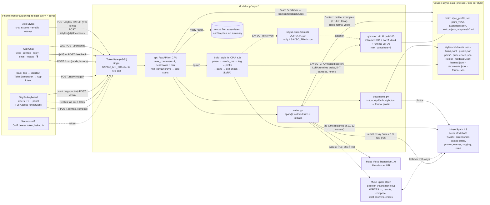

# Architecture review, Nov 2 (architect agent)

Read-only pass with the everything-claude-code `architect` agent over `README.md`, `CLAUDE.md`, `docs/`, `serving/*.py`
and `ios/` (not `data/`, not `.env`, not the generated secrets). No code was changed. Line numbers refer to the tree as
of commit `d9cb2aa`.

## 1. Architecture as built

**Request paths, GPU off (the deployed mode).**

| Path | Calls | Model order (`writer.spark`) | Server per-try timeout | iOS timeout |
|---|---|---|---|---|
| Keyboard ✨ `/rewrite` `/compose` | 1 (2 if compose echoes the instruction) | Open → 1.3 → 1.3 | 30 s each | 20 s |
| Back Tap `/reply` (image) | 1 vision read; drafts returned as-is | 1.3 → 1.3 → Open | 30 s each | 25 s |
| Chat write/rewrite/reply | 1–2 | Open first for writing | 30 s | 45 s |
| Chat email | 1–2 | Open first | 60 s | 45 s |
| Chat essay | plan + text + ≤1 fix pass | 1.3 first | 90 s | 120 s |
| `/transcribe` | 1 | Voice Transcribe, no fallback | 60 s | 60 s |
| `/learn` `/feedback` | 0–2 (rule extraction) | 1.3 first | 30 s | 30 s |

**Learning loop.** Keyboard send (opt-in, own letter keys only) → `/learn` → `learned.jsonl` (+ a rule in
`preferences.json` when a ✨ suggestion was edited). Chat 👍/✏️/👎 → `/feedback` → `feedback.jsonl` (approved
examples) and rules. `styles.version()` changes → `Writer.context()` rebuilds the `Context`, so the next request uses
the new examples (`approved` and `recent` go first) and rules. No LoRA update in the loop.

**Formal documents.** `/styles/{id}/documents` → `documents.py` (quotes, signatures, section labels, PII cut; photos
read by Spark 1.3, not kept) → `documents.jsonl` + `formal.json` → used instead of chat examples for `official`,
`email`, `essay`.

## 2. Risks for the demo (Nov 3 filming) and judging (Nov 5–8)

Judges can't install a free-provisioned build, so judging rests on the video, the repo and any live session the
organisers request. Ranked by likelihood × impact.

| # | Risk | Evidence | Cheap mitigation |
|---|---|---|---|
| R1 | **Hackathon keys stop working** (Baseten key scoped to the event, Meta API quota/standard tier, 429s). Both writer and reader go through two keys; if both fail, every route returns 502. Spark Open can't read images, so the screenshot path has no real fallback. | `writer.py:536-560`, README "hackathon key" | Ask organisers today when both keys expire and their RPM/TPM limits. Keep `SAYSO_WRITER=meta` as a one-env switch. Record every live beat on Nov 3 and keep raw takes as backup for a live session. |
| R2 | **Fallback is slower than the client gives up.** Each try has a 30 s timeout; the keyboard waits 20 s and Back Tap 25 s. If Baseten hangs rather than errors, the client times out before the Spark 1.3 fallback ever runs. Worst case server-side is ~93 s. | `writer.py:536` `timeout=30`; `API.swift:238,260,265` | Per-try timeout ≈ 8–10 s for `writes=True` and reads (Open answers in 2–8 s), or a total deadline that leaves one fallback inside the client's budget. 2-line change; a fake-client test already exists. |
| R3 | **Cold API container.** `api` has no `min_containers`, scales to zero after 5 min, and at startup loads `transformers` and the Glimmer tokenizer from the HF cache volume even with the GPU off. The first ✨ after idle can approach the 20 s keyboard timeout. If the cache volume is ever cleaned, the API can't boot at all (gated model download). | `modal_app.py:127-131, 186-189` | During filming and any live slot: `min_containers=1` on `api` only (CPU, GPU stays off), or open the app 1 min before (any GET boots it). Longer term: load the tokenizer lazily when `SAYSO_GPU=off`. |
| R4 | **Modal spend.** A warm CPU container at the default reservation costs on the order of $1–2 for the 4 judging days (estimate; check the Modal usage page), well inside $5. The real threat is accidental GPU: `SAYSO_GPU` is read at deploy time, `/warmup` wakes an H100 (~$4/h) for anyone with the token, and `SAYSO_TRAIN=on` starts 10–30 min H100 runs. | `modal_app.py:20-23, 520-532` | Deploy with `SAYSO_GPU=off SAYSO_TRAIN=off` and confirm with `/warmup` → `{"gpu": "off"}`. Set a workspace budget limit in Modal. Check whether the monthly Modal credit has reset on Nov 1. |
| R5 | **Free-provisioning expiry.** Profiles last 7 days; a build installed Oct 31 dies Nov 7, mid-judging. Free teams also cap App IDs (10 per 7 days) and devices; app + keyboard extension are two. | `PLAN_final_week.md` "re-sign Nov 3" | Re-sign on Nov 3 or 4 so it lasts to ~Nov 10; write the install date down. Don't change bundle IDs again. |
| R6 | **Single token in the binary** gives read/write to all data (learned messages, rules, delete styles) and lets anyone burn the keys' quotas. | `gen_secrets.sh`, `REVIEW_FINAL.md` S1 | Rotate after filming. Never hand out the IPA; if a judge build is needed, a second generation-only `SAYSO_DEMO_TOKEN` (sketch in `REVIEW_FINAL.md` S1). |
| R7 | **Numbers out of sync.** `eval/results/style_gain_open.json` says Spark Open chrF **50.4** (commit `f1c0fe5`), README and SUBMISSION still say **47.5**. The blind test row is still TODO. | README:230, SUBMISSION:109 | Update both before submitting; judges check claims against committed JSON. Either run the blind test or keep the TODO honest. |
| R8 | **Spark output variance on camera** (an echoed instruction, a lowercase miss). | README "outputs vary" | Film each beat 2–3 times; use the "pasted chat" path as a backup for Back Tap. |

## 3. Path to a real multi-user product

### 3.1 Identity
- **Sign in with Apple** in the app → server verifies Apple's identity token (JWKS) → issues its own short-lived
  access token (15 min) + refresh token, stored in a **shared Keychain access group** so the keyboard extension can
  read it (needs a paid team). Add **App Attest** to bind tokens to a real device and rate-limit per user.
- Every route takes `user_id` from the token; `style_id` becomes `(user_id, style_id)`. Remove the baked-in token.

### 3.2 Per-user storage: DB, not a volume
The volume works for one user because there is one API container and every write calls `data.commit()` and every
read may `data.reload()`. That is last-writer-wins on whole files, with no per-user access control and a global
reload cost. For many users:

| Data | Store | Why |
|---|---|---|
| users, styles meta, rules, feedback, learned rows, formal profile, style profile | **Postgres** (Neon/Supabase), `user_id` on every row, row-level security | Transactional appends instead of rewriting `.jsonl`; deletes are one query |
| own turns, document paragraphs, training pairs | Postgres (JSONB) or object storage per user | Small; read when building a `Context` |
| LoRA adapters (r=16, tens of MB) | **Object storage** (S3/R2) `adapters/{user}/{version}/` | Loaded by vLLM at runtime |
| `latest` replies | Redis/Upstash with a 10-min TTL, keyed by user | Ephemeral |
| `Context` cache | In-process LRU keyed by `(user, style, version)` | Exists already (`Writer.contexts`), just needs bounds |

Encrypt each user's rows and adapters with a per-user data key (KMS envelope encryption); "delete everything" then
also destroys the key (crypto-shredding), which covers backups.

### 3.3 Per-user LoRA training queue
- `training_jobs` table (`user_id, style_id, status, pairs_uri, eval, adapter_uri`), workers claim with
  `SELECT … FOR UPDATE SKIP LOCKED`, or a Modal function with `.spawn()` and a concurrency cap.
- **Batch users per GPU session**: load Glimmer once, train N adapters sequentially (10–30 min each now; shorter on
  incremental refreshes). Model load and cold start are paid once per batch.
- **Eval gate** before promotion: the self-check already in `build_style.py` (form similarity + Spark judge) on held-out
  turns must beat the previous adapter; keep the old one for rollback. Refresh triggers: N new learned rows or monthly.

### 3.4 Multi-LoRA serving
- **< ~2–5k Pro users:** per-token multi-LoRA on a provider, *if* it supports Glimmer 30B LoRAs serverless.
  `CLAUDE.md` says Fireworks serverless has no LoRA for Glimmer and Fireworks uploads are disabled; Together's support is
  unverified. Verify before the README claims it; otherwise this tier is an on-demand deployment billed per GPU hour.
- **Above that:** own vLLM pool. One Glimmer base per H100, `--enable-lora --max-loras 16–32 --max-cpu-loras 256`,
  runtime loading from S3 (already used: `/v1/load_lora_adapter`), **sticky routing by user** (consistent hash) so the
  adapter is hot. Scale on queue depth. Keep the "GPU cold → Spark answers at once" path (`uses_model`): it is the
  right degradation mode.
- Free tier needs no GPU: Spark Open + profile + examples + rules, exactly what runs now. Self-hosting Spark Open on the
  same pool is the lever that changes unit costs.

### 3.5 Cost per active user (sanity check of README's ≈ $3–3.5 → $1–1.5)
The README doesn't state the per-token prices behind "$2.4 for 900 generations + 150 screenshots". The prompt size makes
it plausible: a write carries the profile, up to 8 examples and rules (~2–3k input tokens) and returns the answer plus 4
variants (~0.5k output). At an assumed $0.5/M in and $1.5/M out, 900 × $0.002 + 150 × $0.0035 ≈ **$2.3**. So the line is
consistent *if* those prices hold; state them in the README. What the table leaves out:

| Missing or optimistic item | Effect |
|---|---|
| Onboarding: tagging every turn with Spark 1.3 (batches of 10, 6k max tokens) + self-check + photo reads | One-off, can exceed a month of use for a big export; amortize or cap turns |
| Essays (plan + 6k-token text + fix pass), fallback double calls, rule extraction, transcription minutes | +$0.2–0.5 for heavy users |
| GPU share: "$1,450/month H100 serving 5–10k actives". 900 gens × 7 LoRA samples × ~40 tokens ≈ 250k output tokens per user-month; 10k users ≈ 1k tok/s average, ~4k at peak. That is at the edge of one H100 for a 30B model with LoRA | Plan 2–5k actives per H100 → **$0.3–0.7**, and $1,450 is the cheap end of H100 rent (Modal list ≈ $2.8k/month) |
| LoRA refresh: 10–30 min H100 ≈ $0.7–2 per run | $0.5 holds only with batching and ≤ 1 refresh a month |
| App Store fee 15–30% on $6.99 | Net $4.9–5.9, so a $3.5–5 cost leaves a thin Pro margin |

Realistic now: **≈ $3.5–5 per Pro active**, ≈ $2.5 per Free active (no GPU, no refresh). After self-hosting Spark Open
and prompt caching (the profile + examples prefix is cacheable per user and audience), $1–1.5 is reachable for Pro.
Free-tier caps (generations per day) are needed either way.

### 3.6 Privacy architecture
- **Data classes:** (a) user's own text: stored, encrypted per user; (b) other people's messages (screenshots, pasted
  chats, uploads): processed in memory only, never logged; (c) adapters: derived from (a), same deletion rules.
- **Third-party processors:** today (b) goes to the Meta API and drafts go to Baseten. Production needs zero-retention
  terms with both, then moves live reading to a self-hosted model, as the offline pipeline already did with base Glimmer.
- **Logging:** request bodies never logged (FastAPI + vLLM `--disable-log-requests`), and structured logs carry IDs and
  latencies only.
- **Client:** keyboard learning stays opt-in, secure/typed fields skipped, Full Access explained. Tokens in Keychain,
  not App Group `UserDefaults`.
- **Deletion and export:** one endpoint deletes rows, objects and the user's KMS key, and unloads the adapter.
  Keep the existing privacy tests (`test_styles.py`, `test_privacy.py`) as CI gates on the multi-user code.

## 4. Decision records

### ADR-001: Muse Spark Open writes, Muse Spark 1.3 reads
**Context.** No GPU budget left to host the LoRA; the hackathon Baseten key serves only Spark Open; judges score use
of Meta tooling.
**Decision.** Spark Open (`reasoning_effort: low`) writes everything in the chat formats and emails; Spark 1.3 reads
images and chats, writes essays, and is the fallback, and vice versa (`SAYSO_WRITER=open`).
**Positive.** An open-weights writer gives a credible self-hosting path; 0.93 form similarity, same as Spark 1.3
(0.94); two providers give redundancy; clear story of model roles.
**Negative.** Lower chrF than Spark 1.3 (50.4 vs 53.5); always reasons, so 2–8 s; sometimes echoes the instruction
(extra 1.3 call); no vision, so the screenshot path has no fallback; depends on an event-scoped key.
**Alternatives.** Spark 1.3 for everything (better wording, closed, single provider); LoRA only (best form, no GPU).
**Status.** Accepted, Nov 1.

### ADR-002: TF-IDF example retrieval instead of embeddings
**Context.** Up to 8 of the user's messages go into each prompt; picking by meaning was expected to help.
**Decision.** Approved and newest first, then local TF-IDF nearest neighbours; embeddings removed.
**Positive.** Measured equal to embeddings (0.93 / 53.2) and to random within noise; free; no user text leaves the
server for retrieval; no index to maintain.
**Negative.** Lexical only, so it misses paraphrase across languages (RU/EN/KZ); recomputed per `Context`, so cost grows
with a user's history.
**Alternatives.** Fireworks embeddings (tested, no gain); random examples (equal on metrics, loses topical closeness).
**Status.** Accepted. Revisit only if a metric that rewards topic shows a gap.

### ADR-003: Formal voice comes from the user's own documents, not their chats
**Context.** Chat style (lowercase, slang, emoji) leaks into emails; uploaded homework carries structure ("Argument 2:")
that the model copies.
**Decision.** Separate `documents.jsonl` + `formal.json` per style; essays teach voice only, emails manner only; labels,
quotes and signatures stripped; formal formats never get chat examples and never go through the LoRA.
**Positive.** Formats stop drifting into chat; structure comes from the task; quoted third-party text isn't stored.
**Negative.** Quality is capped by what the user uploads (plain writing without it); a second profile to keep in sync;
photo reads send the user's documents to Spark 1.3.
**Alternatives.** One profile with a formality knob (leaks chat habits); a formal LoRA (no data, no GPU).
**Status.** Accepted.

### ADR-004: Spark drafts with the full chat, the LoRA rewrites
**Context.** Reply chrF is near zero for every system (nobody can predict the exact answer); the LoRA's best task is
rewriting (chrF 57.2 vs 40.7 few-shot).
**Decision.** Spark reads the chat and writes three drafts with different intents; with the GPU on, the LoRA rewrites
each draft, samples 5–7 candidates, and a reranker picks the one closest to a sampled real message from the same
audience × situation.
**Positive.** Splits *what to say* (frontier model, sees context) from *how I say it* (personal model); intents are
controllable; output follows the user's distribution, not their average; degrades cleanly to Spark drafts when cold.
**Negative.** Two model hops (reply 9.7 s from a screenshot when warm); n=7 sampling multiplies GPU tokens; the other
person's messages reach a third-party API.
**Alternatives.** LoRA alone from a summary (v4 "thinks first", kept for the main style without a chat); Spark alone.
**Status.** Accepted; LoRA part dormant while ADR-005 holds.

### ADR-005: GPU off by default (`SAYSO_GPU=off`)
**Context.** Modal credits nearly gone; Fireworks uploads disabled; a cold H100 takes minutes, and the keyboard and App
Intents can't wait.
**Decision.** Deploy with the GPU off; the LoRA path stays in code behind one env flag (`modal` | `baseten`); generation
routes never block on a GPU (503 "warming" or Spark answers).
**Positive.** Near-zero fixed cost; predictable 2–8 s latency; honest status in the README; one flag restores the LoRA.
**Negative.** The headline personal model (fingerprint 0.04) isn't live; the GPU path gets no traffic and can rot
(vLLM image, adapters, tokenizer), so it should be smoke-tested before any claim it works; the API still loads the
Glimmer tokenizer at startup.
**Alternatives.** Keep a warm H100 (≈ $95/day); Baseten LoRA deployment (no key access).
**Status.** Accepted for the hackathon; revisit when credits or a per-token multi-LoRA provider are available.
